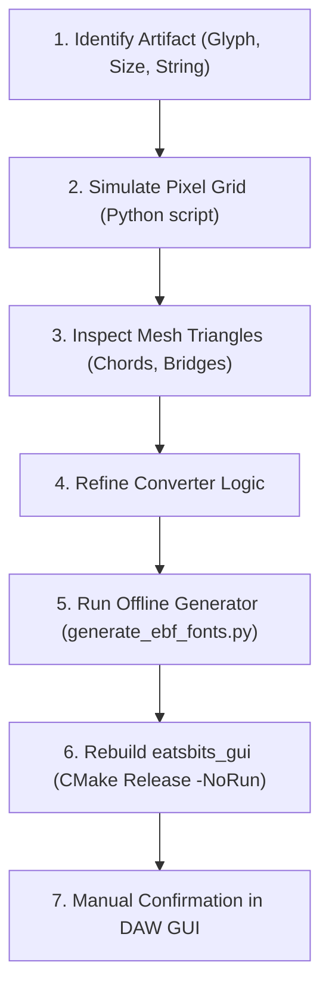

# Eatsbits Glyph Rendering & EBF Typography Workflow

A developer guide and architectural reference for enhancing vector glyph rendering, maintaining the `.ebf` (Eatsbits Font) format, and debugging small-scale rasterization artifacts on a per-item basis.

---

## 1. Architectural Principles

### Pre-Converted EBF at Runtime (Zero Startup Overhead)
- **Runtime Rule:** The DAW application (`eatsbits_gui`) must **never** parse TTF files or run triangulation at startup.
- **Why:** TTF spline decomposition, multi-hole ear-clipping, and kerning extraction across 190+ glyphs introduce startup latency and require shipping bloated TTF files.
- **The Format:** `.ebf` is a compact, uncompressed little-endian binary format storing pre-triangulated vector meshes and metrics. At startup, `EbfFont::loadFromFile` memory-maps or reads the file in a single microsecond-level I/O pass.
- **Offline Conversion:** `.ttf -> .ebf` conversion is strictly an offline tool or engine utility (`tools/generate_ebf_fonts.py` / `EbfConverter`).

### Why the Per-Item Approach is Superior to Blanket Rewrites
At typical desktop UI font sizes (**10px to 14px**), uppercase glyphs are only **9 to 12 pixels tall**, and strokes are only **1.2 to 1.6 pixels wide**.
- **Blanket library changes fail:** External general-purpose polygon triangulation libraries (e.g., standard Mapbox Earcut) do not understand typographic hierarchies (stems vs. counter holes). They routinely connect hole bridges across outer curved perimeters or produce needle slivers, breaking glyphs that previously rendered cleanly.
- **Per-item analysis succeeds:** By isolating problematic glyphs individually, we identify the exact geometric rule (e.g., chord length vs. pixel pitch, bridge placement), and implement generalized solutions in the core converter that enhance both proportional and monospace fonts simultaneously without regressions.

---

## 2. Mathematical Realities of Low-Resolution Vector Glyphs

In a font with $1000 \text{ Units Per EM}$ rendered at $12.5\text{px}$:
$$\text{Scale} = \frac{12.5}{1000} = 0.0125 \implies 1\text{ pixel} = 80 \text{ font units}$$

### The "Giant Chord" Problem
- TrueType outlines define straight lines and gentle curves with very few control points.
- A vertical stem (e.g., in `C`, `D`, `B`) or diagonal leg (in `A`, `S`) often spans **300 to 800 font units** between two consecutive vertices.
- **800 font units $\approx$ 10 pixel rows.**
- If ear-clipping is run without edge subdivision, it connects available vertices with straight chords. A single diagonal triangle edge spanning 800 units traverses 10 pixel rows diagonally.
- Because hardware/software 2D batch renderers evaluate half-plane rules (e.g., top-left rule) without antialiasing, a diagonal traversing a 1.4-pixel-wide stroke cuts across subpixel centers at shallow angles, causing:
  - **Spine breaks:** (e.g., `C` breaking in half at row 11).
  - **Wall dropouts:** (e.g., missing pixels on the right wall of `O`).
  - **Irregular bowls:** (e.g., notched thickness on `D`).
  - **Disconnected clusters:** (e.g., the waist of `S` turning into islands).

### The Golden Metric: Maximum Edge Length $\le 75\text{ Units}$
- By subdividing **all** contour segments (outer and holes) so that no edge exceeds **75 font units**:
- Every edge is physically constrained to **$\le 1$ pixel**.
- Ear-clipping can only generate small, local triangles that tile neatly into quads across strokes.
- Giant diagonal chords across stems become geometrically impossible.

---

## 3. Best Practices & Key Insights Learned

### A. Subdivide All Contours, Not Just Polygons with Holes
- Do not gate subdivision behind `if (!op.holes.empty())`. Single-contour glyphs (`C`, `S`, `E`, `F`, `T`, `Z`) have long straight and curved sections that need subdivision just as much as multi-contour glyphs.
- Subdivide inner hole contours as well so their mesh resolution matches the outer perimeter.

### B. Stem-Biased Bridge Placement
- For multi-contour glyphs with vertical stems and counters (`B`, `D`, `P`, `R`):
  - In TrueType coordinates, counter holes are often closer to the outer curved lobe than to the left stem.
  - A shortest-distance search (`min hypot(dx, dy)`) will mistakenly bridge to the **outer curved perimeter**, slicing the curve and causing exterior nicks.
  - **Fix:** Apply a directional bias (`cost *= 0.6` when $dx \le 1.0$) to force bridges to route **horizontally to the flat vertical stem**, leaving curved lobes completely pristine.

### C. Top-to-Bottom Hole Ordering
- For glyphs with multiple counter holes (e.g., `B`, `8`, `88`):
  - Always sort holes by descending $Y$-centroid before bridging into the outer contour.
  - Splicing from top to bottom prevents bridge chords from self-intersecting.

### D. Contour Orientation / Winding Polarity
- Do not assume outer contours always have positive signed area. In TrueType fonts, clockwise contours evaluate to negative area with the standard surveyor's formula.
- Determine polarity dynamically by comparing the sum of positive vs. negative contour areas:
  ```cpp
  bool outerIsPositive = (totalPosArea >= totalNegArea);
  ```

---

## 4. Step-by-Step Per-Item Diagnosis & Resolution Workflow

When a visual artifact is spotted during manual UI testing:



### Step 1: Identify Context & Font Size
Note the exact string, the font used (`Oswald` vs. `ShareTechMono`), and the rendered `fontSize` (e.g., `12.5f` in `circle_of_fifths_dialog.cpp`).

### Step 2: Simulate Subpixel Rasterization
Use a Python snippet to rasterize the glyph's triangles at the exact font size and print an ASCII grid:
```python
# Check glyph rasterization at 12.5px
scale = 12.5 / 1000.0
baseY = 12.5 * 0.85
# Check top-left fill rule across pixel centers (px + 0.5, py + 0.5)
```
This isolates whether the issue is:
1. A **missing triangle / hole** in the mesh.
2. A **subpixel alignment dropout** caused by a long diagonal chord.
3. An **incorrect bridge attachment point**.

### Step 3: Inspect the Triangles
Check triangle edge lengths and bridge endpoints:
- Are there edges longer than 150 units? $\to$ Needs contour subdivision.
- Is a counter hole attached to a curved perimeter? $\to$ Needs stem-biased bridge routing.
- Are triangles non-manifold (edges shared by $>2$ triangles)? $\to$ Self-intersecting bridge.

### Step 4: Apply Improvements to Core Converter
Make changes in:
- `src/ui/glyph/ebf_converter.cpp` (C++ engine converter)
- `tools/generate_ebf_fonts.py` (Offline Python converter)

### Step 5: On-the-Fly TTF Conversion & Optional Offline .ebf Generation
Eatsbits boots directly from bundled TrueType (.ttf) files (`assets/fonts/Oswald-Medium.ttf`, `assets/fonts/ShareTechMono-Regular.ttf`) using `EbfConverter` on-the-fly at startup (< 5 ms), keeping distribution size minimal without duplicating large pre-tessellated mesh files.

If pre-compiled `.ebf` files are needed for standalone offline environments, run:
```bash
python tools/generate_ebf_fonts.py
```

### Step 6: Compile the Target
Compile `eatsbits_gui` without executing it:
```powershell
cmake --build build --config Release --target eatsbits_gui
```

### Step 7: User Manual Confirmation
Launch `eatsbits_gui.exe` (or `.\build.ps1 -Target eatsbits_gui -Run`) and confirm visual cleanliness in the live DAW window.

---

## 5. Critical Policy Checklist for AI Agents

1. **NO AUTOMATED TESTS:** Never run test suites (`-Test`, `ctest`, `ninja test`, `test_*.exe`). Testing is strictly manual by the user.
2. **NO GPU/AUDIO SUBPROCESSES:** Never launch `eatsbits_gui.exe` or `eatsbits_cli.exe` from background agent subshells. Hardware graphics and audio thread initialization will hang the subshell and lock Windows device contexts.
3. **TTF-FIRST PACKAGING:** TrueType (.ttf) fonts are bundled in `assets/fonts/` and converted dynamically at startup, saving ~240 KB of disk footprint over pre-tessellated `.ebf` files while delivering identical vector rendering performance.
