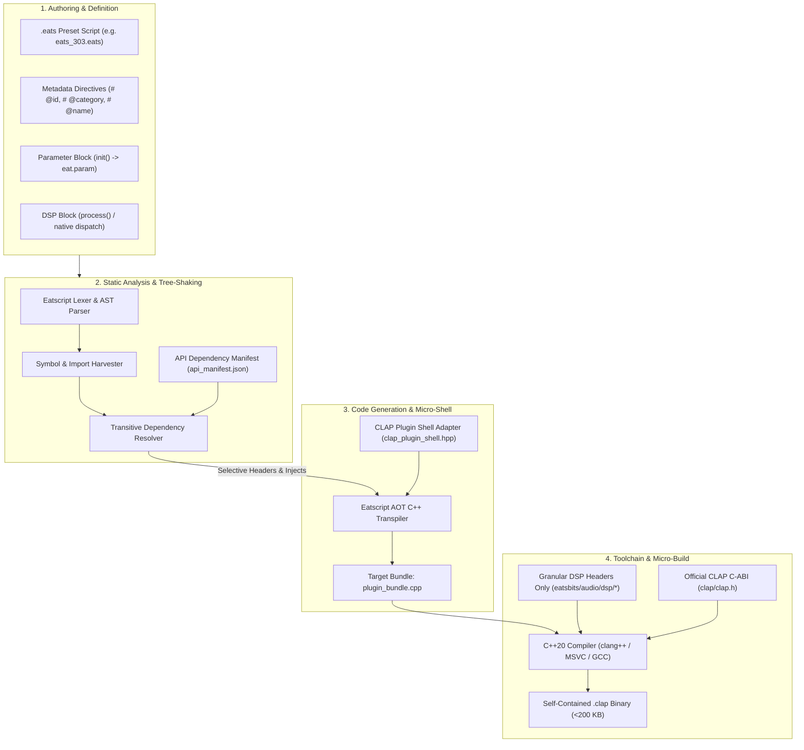

# Eatsbits CLAP Architecture & Selective Micro-Export Blueprint

> **Vision:** Transform Eatsbits into both an extensible CLAP host and an ultra-lightweight instrument/FX export compiler. Users author instruments, synths, and audio effects in the Pythonic Eatscript DSL; the AOT compiler tree-shakes referenced engine subsystems, generates a tailored C++ micro-runtime, and compiles self-contained, zero-VM `.clap` binaries (<200 KB) that run with native performance across Bitwig, Reaper, FL Studio, and other industry DAWs.

---

## 1. Architectural Philosophy & Principles

### 1.1 The Micro-Runtime Paradigm
Traditional DAW and engine export pipelines suffer from runtime bloat:
* **The Embedded VM Pitfall:** Exporting a scripted instrument by bundling an entire language VM (e.g. Python, Lua, or full JavaScript engine) along with general audio drivers introduces high binary weight (20MB–100MB), heap allocations, garbage collection pauses, and non-deterministic real-time behavior.
* **The Monolithic Engine Pitfall:** Linking the entire host DAW engine (`eats_audio`, `eats_render_wgpu`, `miniaudio`) into an exported plugin creates massive binary overhead and DLL dependency friction.

**The Eatsbits Solution:**
1. **Eatscript as an Authoring DSL:** Eatscript is purely an authoring and design environment.
2. **AST-Driven Tree-Shaking:** The compiler analyzes the script's AST, extracts referenced symbols, and computes the exact dependency closure.
3. **C-ABI Micro-Shell:** The compiler embeds a minimal, zero-allocation CLAP adapter (`ClapPluginShell<T>`) that links *only* the specific C++ DSP math modules (e.g., [`tb303_core.hpp`](file:///c:/git/eatsbits/include/eatsbits/audio/dsp/tb303_core.hpp), [`adsr.hpp`](file:///c:/git/eatsbits/include/eatsbits/audio/dsp/adsr.hpp), [`biquad.hpp`](file:///c:/git/eatsbits/include/eatsbits/audio/dsp/biquad.hpp)) needed by the patch.
4. **Hard Real-Time Guarantees:** The exported binary is pure, compiled C++20 with zero heap allocations in the audio processing loop (`process()`).

---

## 2. End-to-End Export Pipeline



---

## 3. The API Dependency Manifest System

To allow automated dead-code stripping, the Eatsbits engine formalizes a declarative **API Dependency Manifest**. This manifest tells the compiler exactly what C++ headers, source files, and engine types correspond to high-level Eatscript imports and function calls.

### 3.1 Manifest Schema (`src/eatscript/api_manifest.json` or C++ constexpr table)
```json
{
  "version": "1.0.0",
  "modules": {
    "eats.dsp.DiodeLadder": {
      "cpp_header": "eatsbits/audio/dsp/tb303_core.hpp",
      "cpp_type": "eatsbits::dsp::DiodeLadderFilter",
      "sources": [],
      "dependencies": ["eats_core"]
    },
    "eats.dsp.TB303": {
      "cpp_header": "eatsbits/audio/dsp/tb303_core.hpp",
      "cpp_type": "eatsbits::dsp::Tb303Core",
      "sources": [],
      "dependencies": ["eats_core"]
    },
    "eats.dsp.PolySynth": {
      "cpp_header": "eatsbits/audio/dsp/poly_synth.hpp",
      "cpp_type": "eatsbits::dsp::PolySynth",
      "sources": [],
      "dependencies": ["eats_core"]
    },
    "eats.dsp.DX7": {
      "cpp_header": "eatsbits/audio/dsp/dx7_core.hpp",
      "cpp_type": "eatsbits::dsp::Dx7Core",
      "sources": ["src/audio/dsp/dx7_core.cpp"],
      "dependencies": ["eats_core"]
    },
    "eats.dsp.YM2612": {
      "cpp_header": "eatsbits/audio/dsp/ym2612_core.hpp",
      "cpp_type": "eatsbits::dsp::Ym2612Core",
      "sources": [],
      "dependencies": ["eats_core"]
    },
    "eats.dsp.SID": {
      "cpp_header": "eatsbits/audio/dsp/sid_core.hpp",
      "cpp_type": "eatsbits::dsp::SidCore",
      "sources": [],
      "dependencies": ["eats_core"]
    },
    "eats.dsp.Biquad": {
      "cpp_header": "eatsbits/audio/dsp/biquad.hpp",
      "cpp_type": "eatsbits::dsp::Biquad",
      "sources": [],
      "dependencies": ["eats_core"]
    },
    "eats.dsp.ADSR": {
      "cpp_header": "eatsbits/audio/dsp/adsr.hpp",
      "cpp_type": "eatsbits::dsp::Adsr",
      "sources": [],
      "dependencies": []
    },
    "eats.fx.ChorusFlanger": {
      "cpp_header": "eatsbits/audio/dsp/chorus_flanger.hpp",
      "cpp_type": "eatsbits::dsp::ChorusFlanger",
      "sources": [],
      "dependencies": ["eats_core"]
    },
    "eats.fx.DynamicsProcessor": {
      "cpp_header": "eatsbits/audio/dsp/dynamics_processor.hpp",
      "cpp_type": "eatsbits::dsp::DynamicsProcessor",
      "sources": [],
      "dependencies": ["eats_core"]
    }
  }
}
```

### 3.2 Automated Dependency Resolution
When `eatscript_cli export --format=clap <script.eats>` is invoked:
1. **Harvesting:** The AST visitor scans:
   - Metadata directives (`# @engine: tb303`, `# @id: eats_303`).
   - Module imports (`from eats.dsp import DiodeLadder, ADSR`).
   - Call expressions (`eat.dsp.Biquad()`, `eat.param(...)`).
2. **Resolution:** Maps harvested identifiers against the manifest, producing:
   - A list of `#include` directives.
   - An exact compilation source file set (often zero `.cpp` files if header-only DSP is used).
   - Preprocessor definitions (`-DEATS_EXPORT_CLAP=1`).

---

## 4. The Minimal CLAP Shell Adapter (`clap_plugin_shell.hpp`)

The CLAP shell adapter is a zero-overhead C++ template that bridges the official C-ABI `clap_plugin_t` to the generated DSP instance.

### 4.1 Architecture & Lifecycles
```
┌─────────────────────────────────────────────────────────────┐
│                       CLAP Host                             │
│               (Bitwig / Reaper / Live)                     │
└───────────────────────────┬─────────────────────────────────┘
                            │ C-ABI Calls (clap/clap.h)
                            ▼
┌─────────────────────────────────────────────────────────────┐
│                 ClapPluginShell<TDspCore>                   │
│  - init() / destroy()                                       │
│  - activate(sample_rate, min_frames, max_frames)            │
│  - process(clap_process_t*)                                 │
│      ├── Parse Input Events (Note On/Off, Param Changes)    │
│      ├── Map Planar Output Buffers (float* left, right)     │
│      └── Execute TDspCore::processBlock(left, right, count) │
│  - clap_plugin_params (reflects eat.param metadata)        │
│  - clap_plugin_state  (JSON/binary state load/save)         │
└───────────────────────────┬─────────────────────────────────┘
                            │ Direct C++ Inlined Calls
                            ▼
┌─────────────────────────────────────────────────────────────┐
│                   Target DSP Core                           │
│   (e.g. Tb303Core / PolySynth / Generated Eatscript Math)   │
└─────────────────────────────────────────────────────────────┘
```

### 4.2 Key Real-Time Design Guarantees
1. **Sample-Accurate Parameter Automation:**
   CLAP provides per-sample parameter updates in `process->in_events` (`CLAP_EVENT_PARAM_VALUE`). The shell sorts and applies parameter updates at the exact sample offset within the block.
2. **Zero Allocation in `process()`:**
   All scratch buffers, voice states, and parameter caches are allocated during `clap_plugin->activate()` and freed in `clap_plugin->deactivate()`. The audio loop performs zero `malloc`/`new`.
3. **Planar Stereo 32-bit Float Audio:**
   CLAP's `clap_audio_buffer_t` uses `float** data32`. This maps directly to Eatsbits' native `outputs[0]` and `outputs[1]`.

---

## 5. Eatsbits as a CLAP Host (Expanding the Workstation)

In addition to export, hosting external CLAP plugins allows Eatsbits desktop users to insert 3rd-party instruments and effects directly into the Arranger and Mixer.

### 5.1 Architecture: `ClapAudioNode`
In [`include/eatsbits/audio/graph/`](file:///c:/git/eatsbits/include/eatsbits/audio/graph/):
* Introduce `ClapAudioNode : public AudioNode`:
  * Holds the dynamically loaded library handle (`HMODULE` on Windows, `dlopen` on Linux/macOS).
  * Wraps `clap_plugin_t`.
  * Passes incoming sequencer MIDI/notes into `clap_event_list`.
  * Bridges planar buffers between Eatsbits' mixer graph and the plugin.

### 5.2 GUI Hosting Strategies
1. **Floating Native OS Windows (Recommended for Desktop):**
   * Use `clap_plugin_gui` (`CLAP_WINDOW_API_WIN32`, `CLAP_WINDOW_API_COCOA`, `CLAP_WINDOW_API_X11`).
   * Spawn a lightweight top-level floating window for the plugin GUI. This cleanly avoids any GLFW / WebGPU swapchain conflicts.
2. **Integrated Generic Parameter UI:**
   * Query `clap_plugin_params`.
   * Automatically generate rotary knobs and faders inside the existing [`TrackPropertiesPanel`](file:///c:/git/eatsbits/include/eatsbits/ui/widgets/track_properties_panel.hpp).
   * Works on any platform, headless setups, or when a plugin has no custom UI.

---

## 6. Phased Implementation Roadmap

### Phase 1: Foundation & Header-Only CLAP Shell
- [x] Vendor official, MIT-licensed `clap/clap.h` headers into `third_party/clap/include/clap/clap.h`.
- [x] Build `include/eatsbits/export/clap/clap_plugin_shell.hpp`:
  - Template class wrapping lifecycle (`init`, `destroy`, `activate`, `deactivate`).
  - Sample-accurate note and parameter event dispatch.
  - Planar float audio buffer routing.
- [x] Create a static reference test: compile `eatsbits_tb303.clap` using [`Tb303Core`](file:///c:/git/eatsbits/include/eatsbits/audio/dsp/tb303_core.hpp) and verify it in a host validator (e.g. `clap-validator`).

### Phase 2: API Dependency Manifest & Tree-Shaking Scanner
- [x] Define the API manifest table in `include/eatsbits/eatscript/api_manifest.hpp`.
- [x] Upgrade [`NativeDispatchScanner`](file:///c:/git/eatsbits/src/eatscript/dispatch_scanner.cpp) into `DependencyScanner`:
  - Scans script AST for `eat.*` API calls and `# @directives`.
  - Resolves required C++ headers and source files from the manifest.
  - Generates parameter descriptions for `clap_plugin_params`.

### Phase 3: AOT Transpiler CLAP Target & CLI Export
- [x] Extend [`Transpiler`](file:///c:/git/eatsbits/src/eatscript/transpiler.cpp):
  - Add `emitClapPluginEntry(const Program& program, const DependencyScanResult& scanResult)`.
  - Generates self-contained `plugin_bundle.cpp` embedding `ClapPluginShell<GeneratedPatchAdapter>`.
  - Emits sample-accurate audio loops and static parameter descriptions from `scanResult.generateClapParamDefs()`.
- [x] Implement `eatscript_cli export --format=clap <script.eats> -o <output.clap>`:
  - Automates generation of `plugin_bundle.cpp` and invokes the host compiler (`cl.exe` / `clang++`) to output the native `.clap` binary.
- [x] Add unit test suite `tests/test_clap_export.cpp` verifying AST harvesting, dependency resolution, code generation, and dynamic host loading.

### Phase 4: Desktop CLAP Host Node
- [x] Create `ClapPluginLoader` for scanning `%CommonProgramFiles%\CLAP` and loading `.clap` libraries.
- [x] Implement `ClapAudioNode` in `eats_audio` for inserting CLAP instruments and FX into track mixer strips.
- [x] Connect `PluginSearchDialog` to list installed external CLAP plugins alongside internal presets.
- [x] Provide floating window display for plugin native GUIs and generic inspector UI fallback.

---

## 7. Immediate Pair-Programming Checklist for New Discussion

When starting the new discussion with Gemini, begin with **Phase 1**:
1. Add `third_party/clap/include/clap/clap.h` (pure C99 header-only library from the official CLAP repository).
2. Implement `include/eatsbits/export/clap/clap_plugin_shell.hpp`.
3. Wrap [`Tb303Core`](file:///c:/git/eatsbits/include/eatsbits/audio/dsp/tb303_core.hpp) in the shell and compile the first minimal native `.clap` artifact.
