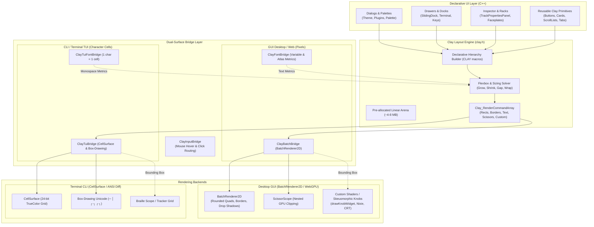
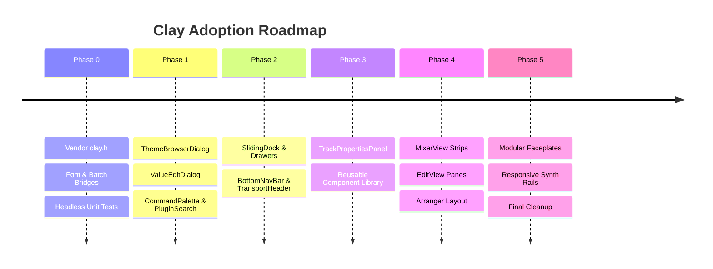

# Unified UI Layout Architecture: Complete Migration to Clay

## 1. Executive Summary & Vision

Eatsbits is migrating from fragmented, imperative coordinate arithmetic to **[Clay](https://github.com/nicbarker/clay)** as its single, unifying 2D layout and UI composition engine.

The ultimate goal is **total reliance on Clay for all graphical layout**:
1. **Zero Manual Pixel Math:** Eliminate thousands of lines of fragile manual coordinate calculations (`x + 12.0f`, `(w - gap) * 0.5f`, `pillX += pillW + 8.0f`) across panels, views, and dialogs.
2. **Unified, Reusable Component Primitives:** Replace redundant ad-hoc implementations of cards, buttons, scroll containers, pills, dialog footers, and tab bars with a centralized library of declarative Clay building blocks.
3. **Decoupled Layout vs. Skeuomorphic Rendering:** Preserve Eatsbits's distinctive visual identity (wood cheeks, 3D lathe-machined knobs, nixie tubes, CRT scopes, and custom vector shaders) by embedding leaf widgets into Clay via `CLAY_CUSTOM_ELEMENT` while Clay handles container layout, sizing, padding, gaps, and clipping.
4. **Deterministic Multiplatform Performance:** Leverage Clay's C99 single-header, zero-runtime-allocation arena architecture across desktop platforms (Windows MSVC, Linux, macOS) and WebAssembly (Emscripten).

To avoid instability while executing a complete overhaul, this migration is structured in **six incremental, independently testable phases**.

---

## 2. Current State & Core Problems

### 2.1 The Coordinate Arithmetic Explosion
Currently, every view and widget imperatively computes its geometry:
* **[theme_browser_dialog.cpp](src/ui/widgets/theme_browser_dialog.cpp#L103-L155):** Manually iterates items to compute grid columns (`cx = x + col * (cardW + gap)`), manages scroll clamping variables, and hardcodes button offsets.
* **[track_properties_panel.cpp](src/ui/widgets/track_properties_panel.cpp#L536):** Over 2,700 lines mingling layout offsets, scissor bounds, hit boxes, and drawing routines.
* **[command_palette_dialog.cpp](src/ui/widgets/command_palette_dialog.cpp#L125), [plugin_search_dialog.cpp](src/ui/widgets/plugin_search_dialog.cpp#L240):** Duplicate custom scrolling, row clipping, and search result list positioning.

### 2.2 Brittle Window Resizing and DPI Scaling
When window dimensions change or UI scale is adjusted (e.g. 1.25x or 2.0x Retina):
* Hardcoded margins cause text overlap or unintentional clipping.
* Components lack a standard flexbox model (min/max sizing, flex grow/shrink, cross-axis alignment, auto-wrapping).

### 2.3 Passive Scene Graph
[Element2D](include/eatsbits/ui/element2d.hpp#L111-L113) provides parent-child hierarchy and `onLayout(bounds, ctx)`, but provides no layout intelligence. Every subclass must re-invent its own positioning and propagate child bounds manually.

---

## 3. Why Clay is the Right Fit

| Requirement | How Clay Fulfills It |
| :--- | :--- |
| **Zero Runtime Heap Allocations** | Runs on a fixed, pre-allocated linear arena buffer (`Clay_CreateArenaWithCapacityAndMemory`). No `malloc`/`free` during UI execution. |
| **High Performance** | Executes hierarchical layout passes in microseconds (< 50 µs for complex trees), well within real-time 60–120 FPS audio workstation budgets. |
| **Platform Portability** | Pure C99 single-header (`clay.h`). Compiles with zero friction on MSVC, Clang, GCC, and Emscripten (WASM). |
| **Pure Layout & Declarative API** | Separates layout calculations from drawing. Outputs a flat, sorted array of render commands (`Clay_RenderCommandArray`). |
| **Perfect Match with [BatchRenderer2D](include/eatsbits/ui/batch_renderer_2d.hpp)** | Clay emits quads, rounded rectangles, borders, text, scissors, and custom elements. Translates 1:1 into Eatsbits's batched GPU drawing. |
| **Extensible via Custom Elements** | Specialized DAW components (custom rotary knobs, waveform displays, piano rolls) plug into `CLAY_CUSTOM_ELEMENT` without compromises. |

---

## 4. Architectural Design



### 4.1 Memory Model & Lifecycle
* **Arena Allocation:** A single static or thread-local arena (`4 MB`) is allocated once during application initialization.
* **Per-Frame Pass:**
  1. `Clay_SetLayoutDimensions({ screenWidth, screenHeight })` (pixels in GUI, character columns/rows in TUI).
  2. `Clay_SetPointerState({ mouseX, mouseY }, isMouseDown)` (pixel coords in GUI, col/row in TUI).
  3. `Clay_UpdateScrollContainers(isDragging, scrollDelta, deltaTime)`
  4. `Clay_BeginLayout()`
  5. Components declare their layout hierarchies using RAII wrapper scopes or `CLAY(...)` blocks.
  6. `Clay_RenderCommandArray commands = Clay_EndLayout()`
  7. **GUI:** `ClayBatchBridge::render(commands, batchRenderer, theme)`
     **TUI:** `ClayTuiBridge::render(commands, cellSurface, theme)`

### 4.2 Text Measurement Integration (`ClayFontBridge` & `ClayTuiFontBridge`)
* **GUI (`ClayFontBridge`):** Connects to dynamic font atlas tables to measure exact pixel widths and line heights.
* **TUI (`ClayTuiFontBridge`):** For monospace terminals, every ASCII character is deterministically $1 \times 1$ cell:
```cpp
Clay_Dimensions measureTerminalText(Clay_StringSlice text, Clay_TextElementConfig* config, void* userData) {
    // 1 cell wide per character, 1 cell high
    return Clay_Dimensions{ static_cast<float>(text.length), 1.0f };
}
```

### 4.3 Command Translation (`ClayBatchBridge` vs `ClayTuiBridge`)
* **GUI (`ClayBatchBridge`):**
  - `CLAY_RENDER_COMMAND_TYPE_RECTANGLE` $\rightarrow$ `BatchRenderer2D::drawRoundedRect(rect, color, radii)`
  - `CLAY_RENDER_COMMAND_TYPE_BORDER` $\rightarrow$ `BatchRenderer2D::drawRoundedBorder(rect, color, radii, borderThickness)`
  - `CLAY_RENDER_COMMAND_TYPE_TEXT` $\rightarrow$ `BatchRenderer2D::drawText(text, pos, color, fontSize)`
  - `CLAY_RENDER_COMMAND_TYPE_SCISSOR_START/END` $\rightarrow$ `batchRenderer.pushScissor(rect)` / `popScissor()`
  - `CLAY_RENDER_COMMAND_TYPE_CUSTOM` $\rightarrow$ invoke custom vector knob or waveform callback.
* **TUI (`ClayTuiBridge`):**
  - `CLAY_RENDER_COMMAND_TYPE_RECTANGLE` $\rightarrow$ `cellSurface.fillRect(roundedRect, bg, ' ')`
  - `CLAY_RENDER_COMMAND_TYPE_BORDER` $\rightarrow$ `cellSurface.drawBox(roundedRect, borderFg, bg, isDoubleLine, title)`
    - Supports rounded corners (`╭ ╮ ╯ ╰`) when `cornerRadius > 0`, standard box characters (`┌ ┐ └ ┘`) when zero.
  - `CLAY_RENDER_COMMAND_TYPE_TEXT` $\rightarrow$ `cellSurface.drawText(roundX, roundY, text, fg, bg, attrs)`
  - `CLAY_RENDER_COMMAND_TYPE_SCISSOR_START/END` $\rightarrow$ cell scissor clipping on `CellSurface`.
  - `CLAY_RENDER_COMMAND_TYPE_CUSTOM` $\rightarrow$ invoke Braille oscilloscope or tracker grid callback with integer cell rect.

---

## 5. Phased Incremental Implementation Plan

To ensure testability and prevent regressions, the transition will occur across six discrete phases.



### Phase 0: Core Foundation & Render Bridge
* **Goal:** Set up Clay within the build system, create the render/font bridges, and verify with automated unit tests.
* **Tasks:**
  1. Add `clay.h` to [third_party/clay/clay.h](third_party/clay/clay.h).
  2. Expose `third_party/clay` in [CMakeLists.txt](CMakeLists.txt).
  3. Implement `include/eatsbits/ui/clay/clay_context.hpp` & `src/ui/clay/clay_context.cpp` (arena lifecycle, config).
  4. Implement `include/eatsbits/ui/clay/clay_batch_bridge.hpp` & `src/ui/clay/clay_batch_bridge.cpp`.
  5. Implement `tests/test_clay_layout.cpp`:
     - Test arena initialization.
     - Test flexbox column/row alignment and wrapping.
     - Verify correct `Clay_RenderCommandArray` generation for nested containers.
* **Verification Gate:** `ctest -R test_clay_layout` passes completely on all target platforms.

---

### Phase 1: High-Churn Modal Dialogs & Palettes
* **Goal:** Replace manual coordinate math in isolated dialogs where layout logic is self-contained.
* **Target Components:**
  1. **[ThemeBrowserDialog](src/ui/widgets/theme_browser_dialog.cpp):**
     - Replace category pill layout loops with flex-row auto-wrap.
     - Replace 2-column card calculation with auto-flowing flex grid.
     - Replace manual scroll offset math with Clay scroll containers.
  2. **[CommandPaletteDialog](src/ui/widgets/command_palette_dialog.cpp):**
     - Declarative search input bar + scrollable fuzzy list + keyboard selection highlight.
  3. **[PluginSearchDialog](src/ui/widgets/plugin_search_dialog.cpp):**
     - Categorized tree/table view with dynamic height scrolling.
  4. **[ValueEditDialog](src/ui/widgets/value_edit_dialog.cpp):**
     - Auto-centered modal card, numeric scrubber, and action button row.
* **Verification Gate:** Visual parity verified; dialogs resize smoothly with zero manual pixel offsets.

---

### Phase 2: Sliding Drawers, Navigation Bars & Docks
* **Goal:** Bring responsive docking and slide-out containers under Clay.
* **Target Components:**
  1. **[SlidingDock](src/ui/widgets/sliding_dock.cpp):**
     - Declarative horizontal/vertical tab strip with dynamic badge counters and active indicator pill.
     - Drawer content bounds automatically calculated via Clay flex container.
  2. **[BottomNavBar](src/ui/widgets/bottom_nav_bar.cpp) & [TransportHeader](src/ui/widgets/transport_header.cpp):**
     - Responsive toolbar layout: pinned left transport controls, centered timecode / tempo display, pinned right telemetry / master volume.
     - Auto-collapsing secondary buttons when window width shrinks.
* **Verification Gate:** Drawers slide out correctly across various screen sizes; toolbars adapt dynamically without overlapping controls.

---

### Phase 3: Inspector Panel & Reusable Component Library
* **Goal:** Break down the monolithic 2,700-line [TrackPropertiesPanel](src/ui/widgets/track_properties_panel.cpp) into modular, reusable Clay components.
* **Reusable Component Library (`eatsbits::ui::clay`):**
  - `UI_Button(label, icon, onClick)`
  - `UI_Pill(label, isSelected, onSelect)`
  - `UI_Card(title, isCollapsible, isCollapsed, contentLambda)`
  - `UI_ScrollList(id, itemsLambda)`
  - `UI_CustomWidget(bounds, renderCallback)`
* **TrackPropertiesPanel Migration:**
  - Track routing & gain strip.
  - Insert effects rack: stack of draggable cards with bypass toggles and parameter knobs.
  - Skeuomorphic instrument preview panel embedded via `UI_CustomWidget`.
* **Verification Gate:** Channel inspection feels smooth, collapses cleanly, and device racks scroll naturally with zero layout bugs.

---

### Phase 4: Core Workspace Views (Arranger, Mixer, Editor)
* **Goal:** Unify top-level workspace layouts.
* **Target Components:**
  1. **[MixerView](src/ui/views/mixer_view.cpp):**
     - Convert mixer strips into an auto-flowing horizontal flex container with per-strip fixed widths.
     - Master strip pinned to the right edge with flex grow space distributing evenly.
     - VU meters and faders embedded via custom element bounds.
  2. **[EditView](src/ui/views/edit_view.cpp):**
     - Split panes: piano roll / step editor main canvas + bottom automation lane + left track headers.
  3. **[ArrangerView](src/ui/views/arranger_view.cpp):**
     - Timeline header bar + track header column + multi-track timeline canvas.
* **Verification Gate:** Resizing the main DAW window automatically reflows mixer strips, expands timelines, and updates scroll bounds seamlessly.

---

### Phase 5: Modular Faceplate Designer (`GuiPanelDef` & `DesignView`)
* **Goal:** Modernize modular synth faceplate layouts.
* **Target Components:**
  - Replace `GuiLayoutMode::AutoRowFlow` in [gui_panel_def.cpp](src/ui/gui_panel_def.cpp) and [DesignView](src/ui/views/design_view.cpp) with Clay layout trees.
  - Enable responsive Eurorack (3U/6U) rail calculations and 19" rack mount spacing.
  - Knobs, sliders, toggle switches, and nixie tubes remain rendered via [drawKnobWidget](include/eatsbits/ui/gui_panel_def.hpp#L231) and analytical shaders, positioned deterministically by Clay.
* **Verification Gate:** Synth modules reflow automatically across virtual rack rails; custom faceplate presets load and lay out identically.

---

### Phase 6: Full Legacy Purge & Deprecation
* **Goal:** Total reliance on Clay; remove all obsolete coordinate code.
* **Tasks:**
  1. Deprecate manual `layout(float w, float h)` signatures across all UI classes.
  2. Adapt [Element2D](include/eatsbits/ui/element2d.hpp) to act natively as a Clay layout declaration node (`virtual void declareLayout(ClayContext& ctx)`).
  3. Delete redundant scrolling math, bounding box clamping, and offset variables.
  4. Perform comprehensive performance profiling (confirm layout + render time < 1.0 ms per frame).

---

## 6. Code Architecture & Concrete Patterns

### 6.1 Declarative Component Example: Theme Browser Dialog
```cpp
void ThemeBrowserDialog::declareLayout(ClayContext& ctx) {
    CLAY({
        .id = CLAY_ID("ThemeBrowserModalOverlay"),
        .layout = {
            .layoutDirection = CLAY_TOP_TO_BOTTOM,
            .sizing = { CLAY_SIZING_GROW(0), CLAY_SIZING_GROW(0) },
            .childAlignment = { CLAY_ALIGN_X_CENTER, CLAY_ALIGN_Y_CENTER },
        },
        .backgroundColor = { 0, 0, 0, 180 }, // Dimmed backdrop
    }) {
        CLAY({
            .id = CLAY_ID("ThemeBrowserDialogCard"),
            .layout = {
                .layoutDirection = CLAY_TOP_TO_BOTTOM,
                .sizing = { CLAY_SIZING_FIXED(780), CLAY_SIZING_FIXED(580) },
                .padding = { 20, 20, 20, 20 },
                .childGap = 16,
            },
            .backgroundColor = theme_.bgElevated,
            .cornerRadius = 12.0f,
            .border = { .width = 1, .color = theme_.border },
        }) {
            // Header: Title & Close Button
            CLAY({
                .layout = {
                    .layoutDirection = CLAY_LEFT_TO_RIGHT,
                    .sizing = { CLAY_SIZING_GROW(0), CLAY_SIZING_FIT(0) },
                    .childAlignment = { CLAY_ALIGN_X_BETWEEN, CLAY_ALIGN_Y_CENTER }
                }
            }) {
                CLAY_TEXT(CLAY_STRING("Theme Presets"), CLAY_TEXT_CONFIG({
                    .fontSize = 20,
                    .textColor = theme_.textPrimary
                }));

                UI_IconButton("close", [this]() { close(); });
            }

            // Category Filter Pills
            CLAY({
                .layout = {
                    .layoutDirection = CLAY_LEFT_TO_RIGHT,
                    .sizing = { CLAY_SIZING_GROW(0), CLAY_SIZING_FIT(0) },
                    .childGap = 8
                }
            }) {
                for (const auto& cat : categories_) {
                    UI_Pill(cat, activeCategory_ == cat, [this, cat]() {
                        selectCategory(cat);
                    });
                }
            }

            // Scrollable 2-Column Cards Grid
            CLAY({
                .id = CLAY_ID("ThemeCardGridScrollContainer"),
                .layout = {
                    .layoutDirection = CLAY_TOP_TO_BOTTOM,
                    .sizing = { CLAY_SIZING_GROW(0), CLAY_SIZING_GROW(0) },
                    .childGap = 12,
                },
                .clipContent = true,
                .scroll = { .vertical = true }
            }) {
                for (size_t i = 0; i < filteredIndices_.size(); i += 2) {
                    CLAY({
                        .layout = {
                            .layoutDirection = CLAY_LEFT_TO_RIGHT,
                            .sizing = { CLAY_SIZING_GROW(0), CLAY_SIZING_FIT(0) },
                            .childGap = 12,
                        }
                    }) {
                        renderThemeCard(filteredIndices_[i]);
                        if (i + 1 < filteredIndices_.size()) {
                            renderThemeCard(filteredIndices_[i + 1]);
                        }
                    }
                }
            }

            // Footer Action Buttons
            CLAY({
                .layout = {
                    .layoutDirection = CLAY_LEFT_TO_RIGHT,
                    .sizing = { CLAY_SIZING_GROW(0), CLAY_SIZING_FIT(0) },
                    .childAlignment = { CLAY_ALIGN_X_END, CLAY_ALIGN_Y_CENTER },
                    .childGap = 12
                }
            }) {
                UI_Button("Cancel", ButtonStyle::Secondary, [this]() { cancel(); });
                UI_Button("Apply Theme", ButtonStyle::Primary, [this]() { apply(); });
            }
        }
    }
}
```

### 6.2 Custom Widget Delegation (`drawKnobWidget`)
```cpp
void renderTrackCutoffKnob(GuiWidgetDef& knobDef) {
    CLAY({
        .id = CLAY_ID("TrackCutoffKnob"),
        .layout = {
            .sizing = { CLAY_SIZING_FIXED(56), CLAY_SIZING_FIXED(56) },
        },
        .customElement = {
            .customData = &knobDef
        }
    });
}

// In ClayBatchBridge::renderCustomElement:
void ClayBatchBridge::renderCustomElement(const Clay_RenderCommand& cmd, BatchRenderer2D& r) {
    auto* widget = static_cast<GuiWidgetDef*>(cmd.customData);
    float cx = cmd.boundingBox.x + cmd.boundingBox.width * 0.5f;
    float cy = cmd.boundingBox.y + cmd.boundingBox.height * 0.5f;
    float radius = std::min(cmd.boundingBox.width, cmd.boundingBox.height) * 0.5f;

    drawKnobWidget(r, cx, cy, radius, widget->currentVal, *widget, lightSource_, isActive_, isHovered_);
}
```

### 6.3 Terminal CLI / TUI Considerations & Example

Clay works exceptionally well for terminal interfaces because it operates on **unit-agnostic coordinates**. For the terminal, **1 unit = 1 character cell**.

#### Key Terminal Considerations:
1. **Integer Coordinate Snapping:**
   - In GUIs, fractional pixel coordinates are anti-aliased. In a terminal, a character cell is atomic.
   - When flexbox percentages or alignments produce fractional values (e.g. `50%` of 81 columns = `40.5`), `ClayTuiBridge` rounds coordinates deterministically (`static_cast<int>(std::round(box.x))`) to prevent 1-cell gaps or accidental column overlaps.
2. **Character Cell Aspect Ratio (1:2):**
   - Terminal character cells are roughly twice as tall as they are wide. A box that is 20 cells wide by 10 cells high will visually appear square. Sizing declarations should account for this aspect ratio when defining layout geometry.
3. **Automatic Mouse & Hover Hit-Testing:**
   - By calling `Clay_SetPointerState({ (float)mouseCol, (float)mouseRow }, isMouseDown)`, terminal mouse clicks and hover highlights work automatically via `Clay_PointerOver(elementId)`.
   - This eliminates all manual bounding box cache variables (`cachedPlayBtn_`, `cachedTabBtns_`) and `.contains(x, y)` loops in [tui_app.cpp](src/tui/tui_app.cpp).
4. **Shared Presenters, Adaptive Layout Density:**
   - As established in [gui-mvp.md](gui-mvp.md), the behavioral models and business logic are unified in headless Presenters.
   - While dialogs (Command Palette, Value Editor) can share identical Clay component definitions, complex screens (Arranger, Mixer) can use terminal-adapted Clay hierarchies optimized for 80–120 column density.

#### TUI Declarative Layout Example:
```cpp
void renderTuiTopPanel(const TelemetrySnapshot& telemetry, bool isInspectorOpen) {
    CLAY({
        .id = CLAY_ID("TuiTopBar"),
        .layout = {
            .layoutDirection = CLAY_LEFT_TO_RIGHT,
            .sizing = { CLAY_SIZING_GROW(0), CLAY_SIZING_FIXED(3) },
            .padding = { 1, 1, 0, 0 },
            .childGap = 1,
            .childAlignment = { CLAY_ALIGN_X_LEFT, CLAY_ALIGN_Y_CENTER },
        },
        .backgroundColor = Color::FromHex(0x101217),
        .border = { .width = 1, .color = Color::DarkGray() },
    }) {
        // Brand logo
        CLAY_TEXT(CLAY_STRING("e:"), CLAY_TEXT_CONFIG({ .textColor = Color::AcidAmber() }));

        // Transport Controls
        UI_TuiButton("PlayBtn", telemetry.isPlaying ? " ▶ PLAY " : " ▶ Play ",
                     telemetry.isPlaying ? Color::NeonGreen() : Color::DarkGray(),
                     telemetry.isPlaying ? Color::Black() : Color::White());

        UI_TuiButton("StopBtn", !telemetry.isPlaying ? " ⏹ STOP " : " ⏹ Stop ",
                     !telemetry.isPlaying ? Color::DangerRed() : Color::DarkGray(),
                     Color::White());

        // Stats ticker (Flex grow to fill middle)
        CLAY({
            .layout = {
                .sizing = { CLAY_SIZING_GROW(0), CLAY_SIZING_FIXED(1) },
                .childAlignment = { CLAY_ALIGN_X_CENTER, CLAY_ALIGN_Y_CENTER }
            }
        }) {
            char stats[64];
            snprintf(stats, sizeof(stats), "TEMPO: %5.1f BPM │ 4/4 │ CPU: 1.6%%", telemetry.bpm);
            CLAY_TEXT(CLAY_STRING(stats), CLAY_TEXT_CONFIG({ .textColor = Color::White() }));
        }

        // Pinned Right: Inspector toggle
        UI_TuiButton("BrowserBtn", " [▤ BROWSER] ",
                     isInspectorOpen ? Color::AcidAmber() : Color::DarkGray(),
                     isInspectorOpen ? Color::Black() : Color::White());
    }
}
```

---

## 7. Risk Assessment & Mitigation

| Risk | Impact | Mitigation Strategy |
| :--- | :--- | :--- |
| **Breaking Existing Complex Views during Migration** | High | Migrate one dialog/panel at a time. The dual-mode architecture allows legacy `onLayout()` and Clay components to coexist seamlessly until Phase 6. |
| **Arena Memory Overflow** | Medium | Clay allows querying required memory upfront (`Clay_MinMemorySize()`). Set a generous fixed arena (8 MB) and include runtime warnings if capacity exceeds 75%. |
| **Text Measurement Inconsistencies** | Medium | Connect `Clay_SetMeasureTextFunction` directly to the active font metric table. In TUI, use deterministic $1 \times 1$ monospace measurement. |
| **Input Handling & Event Synchronization** | Low | Query Clay's built-in pointer state (`Clay_PointerOver(elementId)`) while bubbling events through `Element2D::dispatchPointer`. |
| **Terminal Integer Rounding Artifacts** | Low | Implement integer bounding box quantization in `ClayTuiBridge` to ensure no 1-cell gaps or border clipping occurs. |

---

## 8. Summary Checklist for Developers

- [x] **Phase 0:** Vendor `clay.h`, implement `ClayBatchBridge` (GUI) and `ClayTuiBridge` (CLI/TUI), write passing unit test `test_clay_layout`.
- [x] **Phase 1:** Convert `ThemeBrowserDialog`, `ValueEditDialog`, `CommandPaletteDialog`, `PluginSearchDialog`.
- [x] **Phase 2:** Convert `SlidingDock`, `BottomNavBar`, `TransportHeader` (GUI) and Top/Bottom navigation panels in `TuiApp` (CLI).
- [x] **Phase 3:** Create reusable Clay component primitives; refactor `TrackPropertiesPanel` and TUI Param Rack.
- [x] **Phase 4:** Convert `MixerView`, `EditView`, and `ArrangerView` layout containers (GUI & TUI).
- [x] **Phase 5:** Modernize modular synth faceplate layouts in `DesignView` & `GuiPanelDef`.
- [x] **Phase 6:** Remove legacy coordinate math, deprecate cached hit rects in TUI, and complete full migration.
